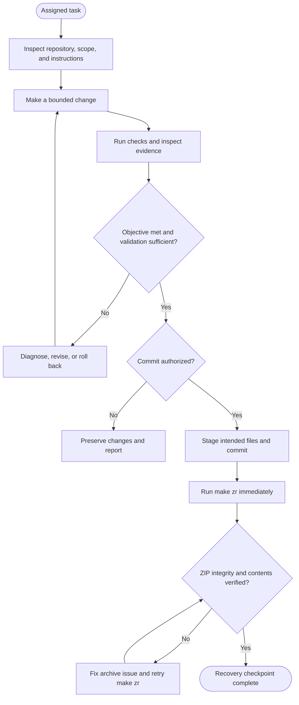
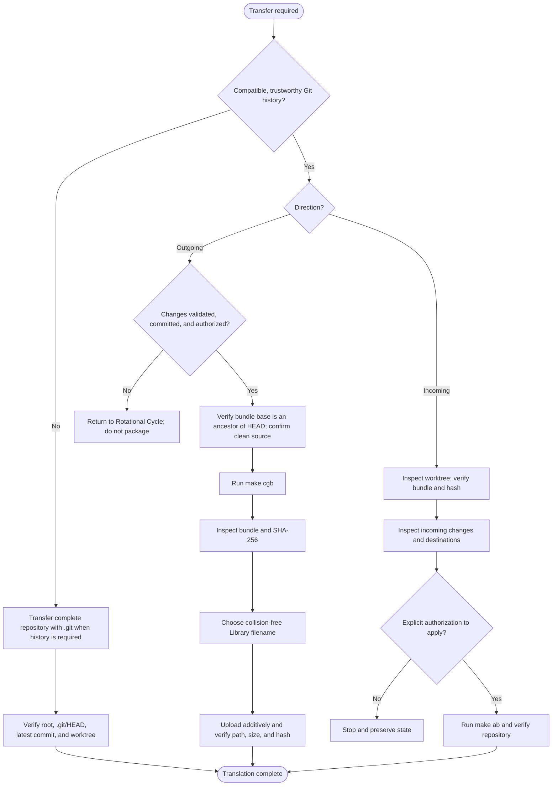

# README — AI Quick Reference

**Purpose:** Compact operational context for an AI joining or resuming work on the Trading Intel repository. This AI-oriented entry point is generated from `README/000_ai_entry_point.md` with `make grr`. The `README/` directory contains the detailed, human-readable project documentation; those modules are also authoritative working references for AI agents. Read the relevant documents there before performing substantive work.

## Roles and workflows

- **Architect:** generally the human who owns the repository and directs the work.
- **Engineer:** generally the AI or another human who inspects, implements, validates, and returns authorized changes.
- **Translational Cycle (Data Interchange Cycle, DIC):** moves repository state and work between the Architect's persistent environment and the Engineer's workbench.
- **Rotational Cycle (Iterative Development Cycle, IDC):** accomplishes tasks and advances development through repeated implementation, execution, testing, evaluation, and refinement.
- The Rotational Cycle can operate independently. The Translational Cycle accommodates its results when work must move between environments; keep that relationship minimal rather than repeating rotational procedures.
- The Architect primarily leads translation and the Engineer primarily leads rotation, but both participate in both cycles. See `README/015_collaboration_cycles_and_roles.md` for the collaboration model and Earth analogy.

## Rotational Cycle — operational flow

Use this loop to accomplish and validate work in the Engineer's workbench. It can run independently; a transfer is not implied by a completed rotation.

Operational guardrails: preserve unrelated changes; validate before committing; never commit without authorization; after every successful commit, run `make zr` and verify `trading_intel.zip`. The ZIP is a complete local recovery checkpoint. **Keep it in the workbench; do not upload it as the routine transfer artifact.**

## Translational Cycle — operational flow

Use this loop only when repository state must move between environments. Prefer an incremental Git bundle when both repositories have compatible, trustworthy history; use a complete repository transfer for bootstrap or recovery.

Operational guardrails: outgoing routine transfers use `make cgb`, then an additive, collision-safe Library upload and verification. Incoming bundles require inspection and explicit authorization before `make ab`; that target does not apply incoming deletions. Complete transfers must preserve Git history when required.

**Do not confuse the two artifacts:** `make zr` creates the full workbench recovery ZIP; `make cgb` creates the incremental transfer bundle. A recovery checkpoint does not trigger an upload. When a transfer is required, deliver the bundle—not another complete ZIP.

## Translational Cycle — Data Interchange Cycle (DIC)

Choose the transfer method according to repository state:

- Use a **complete repository transfer** when the Engineer's workspace is new, unavailable, wiped, or untrustworthy. Include `.git/` when history must be preserved.
- Use **incremental Git bundles** for routine exchange when both repositories share compatible history.

For a new Engineer workspace:

1. Obtain and extract the repository or the agreed incoming bundle; work from the repository root.
2. Verify `git rev-parse --show-toplevel`, `git status --short`, and `git log -1`.
3. Run `make itd` to initialize temporary refresh-trigger dependencies before Make targets that rely on them.
4. Run `make ugu` to remove repository-local identity overrides before configuring the global identity; local values can otherwise override the global values.
5. Configure your own global Git identity in your development environment. Set `user.name` and `user.email` to the identity you use when contributing, whether you are a human developer or an AI operating independently. For example: `git config --global user.name "Your Name"` and `git config --global user.email "you@example.com"`. Use an identity that belongs to you; never attribute commits to another person or contributor.
6. Verify identity and configuration origin with `git config --show-origin --get user.name`, `git config --show-origin --get user.email`, `git var GIT_AUTHOR_IDENT`, and `git var GIT_COMMITTER_IDENT`. Confirm that the effective values identify you as the contributor, not another person.
7. Do not commit until the effective author and committer identities are correct.

For routine bundle exchange:

- Incoming bundle: inspect and protect local changes; verify with `git bundle verify update.bundle`; compare `sha256sum update.bundle` with `.update.bundle.sha256` when the marker exists; inspect the intended changes. `make ab` applies incoming additions, modifications, and rename destinations since the common Git ancestor; it preserves paths absent from the bundle and does not apply deletions. It aborts on staged changes or conflicting local modifications/untracked destination files. Obtain explicit authorization before running it.
- Outgoing bundle: ensure authorized work is validated and committed; confirm the configured base commit in `sh/lib.sh` exists and is an ancestor of `HEAD`; run `make cgb`; inspect `update.bundle` and its hash. Then inspect the destination and select the next available filename using the general collision rule: `update.bundle`, then `update(1).bundle`, `update(2).bundle`, and so on. Do not rely on automatic duplicate naming or timestamps. Upload additively to `/finances/030_trading_intel/`; never overwrite or delete existing bundles. The Engineer's `/mnt/data/` workspace is private and inaccessible to the Architect; a sandbox link is not delivery. Verify and report the exact Library path, size, and SHA-256 hash.
- A complete archive transfer must preserve `.git/` when history is required. After extraction, verify the repository root, `.git/HEAD`, expected latest commit, and working-tree state.

## Rotational Cycle — Iterative Development Cycle (IDC)

The cycle is iterative. There is no permanently fixed original snapshot: every new snapshot becomes the baseline for the next iteration. Always compare the two most recent snapshots.

### Initialize and inspect

1. Read the project's IDC configuration in `README/` before running project-specific commands.
2. Initialize the local test path and verify its active mode using the project's documented procedure. Never toggle a mode without first checking its current state.
3. Inspect the source, dependencies, and inputs that the iteration is intended to exercise.

### Generate analysis data and capture a snapshot

1. Run the configured data-preparation or test-processing procedure under the established test conditions.
2. Invoke the project's configured **Data Generator** to emit standardized, analysis-ready data. The Data Generator is a project-defined mechanism; it is not assumed to be a report or visualization.
3. Apply the project's documented deterministic normalization, ordering, or filtering before saving the output as the next numbered snapshot.
4. Confirm that every stage succeeded and inspect the captured output. A missing-input message, empty output caused by an upstream failure, or masked command failure is not a valid snapshot.

### Iterate and compare

Repeat the controlled sequence:

`modify -> inspect source -> prepare data -> invoke Data Generator -> normalize -> capture next snapshot -> compare consecutive snapshots -> analyze`

Use the project's established snapshot naming convention. Compare the newest snapshot with the immediately preceding snapshot; preserve earlier snapshots and do not create pair-named comparison files unless explicitly required. Keep inputs, filters, execution conditions, generator options, and output formatting consistent. If the result is inconclusive, improve diagnostics and capture another snapshot. The newest snapshot becomes the baseline for the next iteration.

### Post-commit recovery archive

Immediately after **every successful Git commit**, run the project's configured repository archive target and verify the archive's integrity before continuing the Rotational Cycle. For Trading Intel, run `make zr` and verify `trading_intel.zip`; this project-local ZIP is the workbench recovery checkpoint, not a DIC bundle. If archive creation or validation fails, the commit remains valid but the recovery checkpoint is incomplete; resolve the failure and retry the archive step without making another commit.

For this repository, consult `README/040_trading_intel_project.md` for the configured Data Generator, data-preparation procedure, snapshot normalization, and archive recovery procedure. See `README/030_iterative_development_cycle.md` for the complete generic Rotational Cycle procedure.

## Safety and working rules

- Inspect the current repository state before acting; preserve unrelated changes.
- Read the current Makefile rules before running targets with acquisition, repository, or other side effects. A target's presence in help does not prove it is safe or validated in the current environment.
- Do not run production acquisition, apply an incoming bundle, commit, push, or overwrite persistent artifacts without the required authorization.
- Stage only files belonging to the authorized change. Do not add a remote or push unless explicitly authorized.
- Keep execution evidence, source changes, validation, commits, user acceptance, packaging, and persistent delivery distinct. Report only what was actually performed and verified.

## Project landmarks

- `makefile` — project entry point and Make orchestration.
- `mk/` — included Make rules.
- `sh/` — shell utilities and shared functions.
- `jq/` — jq filters and utilities.
- `py/` — Python processing code.
- `data/` — inventory data and test fixtures.
- `work_items/open/` and `work_items/completed/` — work-item tracking.
- `README/` — detailed modular documentation for humans and AI agents; consult the relevant documents before substantive work.
- `.git/` — repository history and metadata; preserve when transferring the complete repository.

**Documentation source:** maintain the AI-oriented content in `README/000_ai_entry_point.md` and regenerate this root file with `make grr`. The numbered documents under `README/` contain the detailed explanations, procedures, and rationale; `README/010_overview.md` explains the documentation hierarchy.

**Path assumption:** current Makefile path logic expects the checkout directory to be named `trading_intel` directly under its workspace root. Verify the actual checkout location and configured data paths before running the pipeline or viewer.
