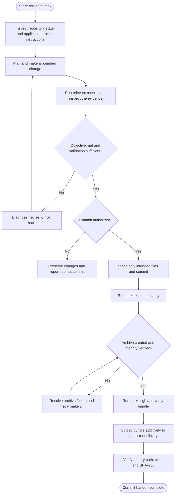

# Rotational Cycle — Execution Procedure

## Purpose

Use this procedure to accomplish and validate a bounded task in the Engineer's workbench. The Rotational Cycle can run independently of any transfer between environments.

## Operational flow

## Required sequence

1. Inspect the repository state, task scope, relevant source, dependencies, and applicable project instructions before changing files.
2. Make a bounded change. Preserve unrelated worktree changes.
3. Execute the relevant validation procedure and inspect actual results. Do not infer success from command completion alone.
4. If validation fails or is inconclusive, diagnose and iterate. Do not commit an unexplained result.
5. Commit only when explicitly authorized. Stage only files belonging to the authorized change, including directly related bookkeeping when applicable.
6. Before packaging, ensure the tracked worktree contains only the committed state. Preserve unrelated changes safely and isolate them from the packaging worktree; never discard them. This ensures the recovery ZIP represents the commit and satisfies `make cgb`'s clean-worktree requirement.
7. Immediately after every successful commit, run `make zr` and verify the resulting `trading_intel.zip` for integrity and expected repository contents. If this checkpoint fails, retry the archive operation; do not make another commit merely to retry it.
8. Then run `make cgb`, verify the resulting incremental Git bundle and its SHA-256, and upload it additively to `/finances/030_trading_intel/`. Choose a collision-free filename; never overwrite or delete an existing bundle. Verify the exact Library path, size, and SHA-256 before continuing. Keep the ZIP in the workbench as the local recovery checkpoint; upload the bundle as the durable synchronization artifact. Restore any safely preserved unrelated changes after both artifacts have been created and delivered.

## Completion rule

Report the task result, validation evidence, commit status, ZIP recovery-checkpoint status, and bundle-delivery status separately. Every successful commit initiates the required outgoing DIC bundle handoff; this is not an optional transfer decision.
