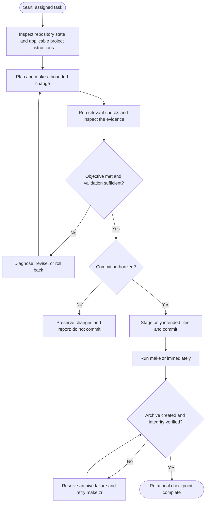

# Rotational Cycle — Execution Procedure

## Purpose

Use this procedure to accomplish and validate a bounded task in the Engineer's workbench. The Rotational Cycle can run independently of any transfer between environments.

## Operational flow

## Required sequence

1. Inspect the repository state, task scope, relevant source, dependencies, and applicable project instructions before changing files.
2. Make a bounded change. Preserve unrelated worktree changes.
3. Execute the relevant validation procedure and inspect actual results. Do not infer success from command completion alone.
4. If validation fails or is inconclusive, diagnose and iterate. Do not commit an unexplained result.
5. Commit only when explicitly authorized. Stage only files belonging to the authorized change, including directly related bookkeeping when applicable.
6. Immediately after every successful commit, run `make zr` and verify the resulting `trading_intel.zip` for integrity and expected repository contents. If this checkpoint fails, retry the archive operation; do not make another commit merely to retry it.
7. Keep the recovery ZIP in the workbench as its local recovery checkpoint. **Do not upload it as the routine transfer artifact.** A transfer, when needed, belongs to the Translational Cycle and uses an incremental Git bundle.

## Completion rule

Report the task result, validation evidence, commit status, and recovery-checkpoint status separately. Completing a Rotational Cycle does not by itself initiate a Translational Cycle.
