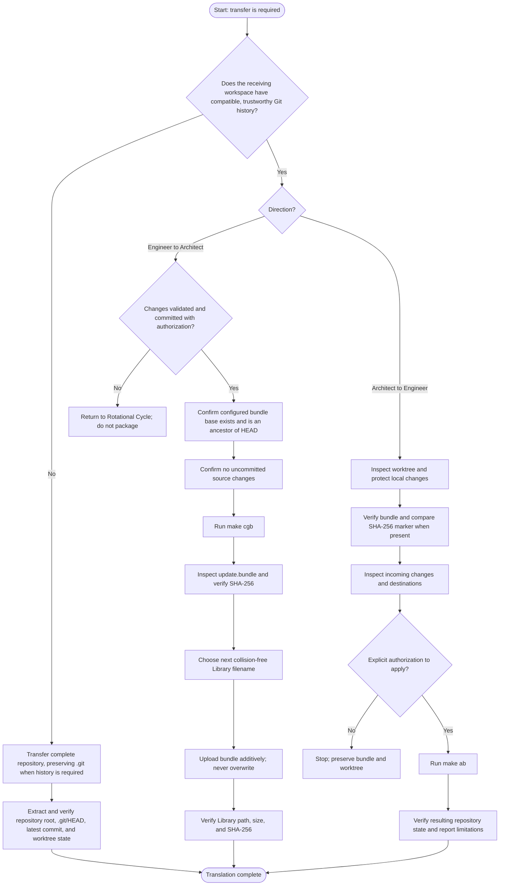

# Translational Cycle — Execution Procedure

## Purpose

Use this procedure only when repository state must move between the Architect's persistent environment and the Engineer's workbench. Routine exchanges use incremental Git bundles; complete repository transfers are reserved for bootstrap or recovery.

## Operational flow

## Engineer-to-Architect transfer

1. Confirm that a transfer is actually required. A successful commit and its local recovery checkpoint do not automatically require a transfer.
2. Confirm the work is validated, committed, and authorized for exchange. Preserve unrelated worktree changes; `make cgb` refuses uncommitted source changes.
3. Verify that the configured bundle base commit exists and is an ancestor of `HEAD`.
4. Run `make cgb`. Inspect `update.bundle`, run bundle verification, and calculate its SHA-256 hash.
5. Inspect the persistent destination before naming the artifact. Use `update.bundle` if available; otherwise use the next available integer suffix, such as `update(1).bundle`. Never overwrite or delete an existing bundle.
6. Upload the incremental bundle to `/finances/030_trading_intel/`. Verify and report its exact Library path, size, and SHA-256 hash.

## Architect-to-Engineer transfer

1. Inspect the receiving worktree and preserve local changes.
2. Verify the incoming bundle with `git bundle verify`; compare its SHA-256 with `.update.bundle.sha256` when that marker exists.
3. Inspect the incoming changes and destination paths. Understand that `make ab` applies additions, modifications, and rename destinations; it does not apply incoming deletions.
4. Obtain explicit authorization before applying the bundle. Then run `make ab` and verify the resulting repository state.

## Complete repository transfer

Use a complete repository transfer when the receiving workspace is new, unavailable, wiped, or cannot be reconciled safely. Preserve `.git/` when history is required. After extraction, verify the repository root, `.git/HEAD`, expected latest commit, and worktree state.

## Hard boundary

`make zr` creates the Engineer's complete, local workbench recovery ZIP. `make cgb` creates the incremental transfer bundle. **Never upload the recovery ZIP as a substitute for the routine Git bundle.** The ZIP protects against loss of the ephemeral workbench; the bundle carries committed changes between the two environments.
